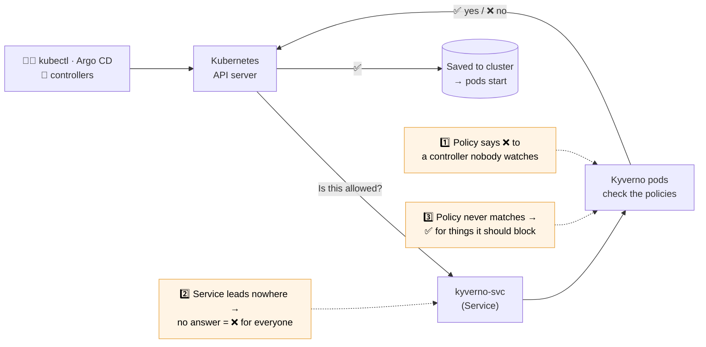

# Lab: Policy / Kyverno — what breaks, and what's the impact

⏱ **15 minutes** · 🧩 standalone (no other lab needed) · 🛠 Kyverno v1.19.1 on kind

> **New to Kyverno?** [Kyverno](https://kyverno.io) is a CNCF graduated policy
> engine for Kubernetes. Teams write rules as ordinary Kubernetes resources
> ("no privileged pods", "every pod needs an owner label", "only signed images"),
> and Kyverno checks every change against them **before the cluster saves it**:
> it can block or warn (validate), fix things on the way in (mutate), create
> defaults (generate), and check image signatures. You don't need to know how to
> write policies for this lab; you'll investigate them.

Your policy engine sits in the request path of **every** change to the cluster.
When it breaks, it rarely looks like "Kyverno is broken". It looks like
*"my app vanished"*, *"Argo CD can't sync"*, or worse — *nothing at all*.

## How a change reaches the cluster

Every create or update — from you, Argo CD, or a Kubernetes controller —
stops at Kyverno before it's saved. Each scenario breaks a different step.



You'll break the platform three ways and fix it each time. Scenarios are
independent: do them in any order, skip any of them.

> 🧗 **Experienced with Kyverno?** Try [`CHALLENGE.md`](CHALLENGE.md):
> same scenarios, no hints, no copy-paste fixes.

| # | Scenario | What you'll see | Time |
|---|----------|-----------------|------|
| 1 | The rollout that never rolls | App has 0 pods, nobody touched it | ~5 min |
| 2 | Kyverno is down, so is your platform | Every change in the cluster is rejected | ~4 min |
| 3 | The guardrail that guards nothing | Policy is READY, but lets everything through | ~5 min |
| ✅ | Catch it before production | The checks that would have stopped 1 and 3 | ~2 min |

---

## 0. Get ready

There are two ways to run this lab. **At the workshop, use Option A.**

| | Option A: GitHub Codespaces | Option B: your own computer |
|---|---|---|
| Install anything? | No. It runs in your browser | Docker, kind, kubectl, Kyverno CLI |
| Time to start | 2–8 minutes (one-off) | 5 minutes plus installs |
| Touches your clusters? | No. It's a separate cloud machine | Only its own local cluster (see safety notes) |
| Cost | Free tier includes 120 hours a month (a 4-core machine counts 4×); this lab uses about 2 | Free |

### Option A — GitHub Codespaces (recommended)

1. Sign in to GitHub (a free account is fine).
2. On this repository (no fork needed), select **Code** > **Codespaces**, then
   **...** > **New with options**. Choose:

   | Setting | Value |
   | --- | --- |
   | Branch | `main` |
   | Dev container configuration | **Kyverno policy workshop** |
   | Machine type | 4-core |

   Then select **Create codespace**.
3. Wait until the terminal at the bottom prints **Lab ready** (2–8 minutes the
   first time; it's building a small Kubernetes cluster just for you).
4. In that terminal:

   ```bash
   cd /workspaces/*/kyverno-policy-workshop
   ./lab.sh status
   ```

   You should see `Cluster: kind-kyverno-lab`, four Kyverno deployments at
   `1/1`, and `shop` at `2/2`. Not there? Run `./lab.sh setup` (about 2 minutes).

When you're done, stop the Codespace so it doesn't use your free hours:
[github.com/codespaces](https://github.com/codespaces) → **⋯** → **Stop codespace**.

### Option B — Your own computer

**You need** macOS or Linux (on Windows, use [WSL2](https://learn.microsoft.com/windows/wsl/install)
with Docker Desktop and run everything inside the WSL terminal), about 4 GB of
free memory, and these tools:

| Tool | What it's for | Required? | Install (macOS) | Install (Linux / WSL) |
|---|---|---|---|---|
| Docker | Runs the lab's cluster as a container | Yes, **and it must be running** | [Docker Desktop](https://docs.docker.com/desktop/) | [Docker Engine](https://docs.docker.com/engine/install/) |
| kind | Creates the local Kubernetes cluster | Yes | `brew install kind` | [kind install](https://kind.sigs.k8s.io/docs/user/quick-start/#installation) |
| kubectl | Talks to the cluster | Yes | `brew install kubectl` | [kubectl install](https://kubernetes.io/docs/tasks/tools/#kubectl) |
| Kyverno CLI | Runs policies offline (Scenario 3 and Last step) | Optional, see below | `brew install kyverno` | [Kyverno CLI install](https://kyverno.io/docs/kyverno-cli/install/) |

**If you already use kubectl with real clusters** (work, staging, production),
read [Already connected to a cluster?](#already-connected-to-a-cluster-read-this-first)
before you start. It takes one minute.

Then:

```bash
git clone https://github.com/reggie-k/kubecon-na-2026-most-boring-talk.git
cd kubecon-na-2026-most-boring-talk/kyverno-policy-workshop
export KUBECONFIG="$HOME/.kube/kyverno-lab"    # keeps the lab separate from your real clusters
./lab.sh setup
./lab.sh status
```

`setup` checks your tools first and tells you exactly what's missing (for
example "Docker is installed but not running"). It then creates a kind cluster
called `kyverno-lab`, installs Kyverno 1.19.1 into it, and deploys the sample
app. `status` should show `Cluster: kind-kyverno-lab`.

When you're done:

```bash
./lab.sh cleanup        # deletes the lab's kind cluster, and nothing else
unset KUBECONFIG        # back to your normal kubectl setup
```

### Already connected to a cluster? Read this first

This lab **breaks Kyverno on purpose** (Scenario 2) and changes policies and
pods. It's designed to do that only on its own throwaway cluster.

- **`lab.sh` only works on the lab cluster.** It checks that kubectl points at
  `kind-kyverno-lab` and refuses to run anywhere else.
- **The `kubectl` commands you copy from this README are not protected.** They
  go to whatever cluster kubectl currently points at. If you switch context
  mid-lab, a command like Scenario 2's `kubectl -n kyverno patch svc ...` would
  change a real cluster's Kyverno.
- **Best practice: use a separate kubeconfig.** Run
  `export KUBECONFIG="$HOME/.kube/kyverno-lab"` in the terminal *before*
  `./lab.sh setup`. The lab cluster is then the only cluster that terminal can
  see, and your normal `~/.kube/config` isn't touched. Close the terminal (or
  `unset KUBECONFIG`) when you're done.
- **Check before you change anything:** `kubectl config current-context` must
  say `kind-kyverno-lab`. `./lab.sh status` prints it too.
- **Don't run this on a shared cluster.** For a disposable cluster of your own
  instead of kind, there's an opt-in: `LAB_CONTEXT=<your-context> ./lab.sh setup`.
  It installs Kyverno there if it's missing, and Scenario 2 will break it.
  If that cluster already runs a different Kyverno version, outputs may differ.

### About the Kyverno CLI

The **Kyverno CLI** (the `kyverno` command) runs Kyverno policies against
YAML files on your computer, **without a cluster**: the same policy engine,
just offline. Teams use it in CI to test policies before they're merged.

- **Do you need it?** Only for two steps: Scenario 3's "prove it offline" check
  and the Last step. Everything else uses `kubectl`. Without it you can still
  complete and pass all three scenarios; you'll just skip those checks.
- **Is it safe?** Yes. In this lab it only reads files in this folder. It never
  connects to any cluster.
- **Version:** the lab uses 1.19.1 (`kyverno version` shows yours). Older
  versions may not understand the `policies.kyverno.io/v1` policies used here.
- **Codespaces:** already installed.
- **Not the same as Kyverno itself.** Kyverno (the admission controller) runs
  *inside* the cluster; `lab.sh setup` installs it there for you.

### How every scenario works

```bash
./lab.sh break 1     # break it (also resets anything from earlier)
# ...investigate and fix...
./lab.sh check 1     # ✅ or ❌ with a hint
./lab.sh reset       # back to healthy at any time
```

---

## Scenario 1 — The rollout that never rolls

```bash
./lab.sh break 1
```

**Symptom.** `shop` has 0 running pods. No crash loop, no logs, nothing to read.

**Investigate.** Work down the chain: Deployment → ReplicaSet → Pods.

```bash
kubectl -n shop get deploy,rs,pods
```

No pods means no pod logs. Pods are created by the ReplicaSet controller, so
check *its* events:

```bash
kubectl -n shop get events --field-selector reason=FailedCreate -o custom-columns=FROM:.source.component,MESSAGE:.message | tail -2
```

<details><summary>What you should find</summary>

The **ReplicaSet controller** tried to recreate the pods and got
`admission webhook "vpol.validate.kyverno.svc-fail" denied the request: Policy require-team-label failed: Pods must have a 'team' label...`

Nobody saw it because *a human didn't make that request — a controller did*.
The Deployment itself was accepted long before the policy existed.
</details>

**Fix it (pick one).** Do **not** delete the policy.

- **Fix the app** — the policy is right, the app is non-compliant:
  ```bash
  kubectl -n shop patch deploy shop --type merge -p '{"spec":{"template":{"metadata":{"labels":{"team":"payments"}}}}}'
  kubectl -n shop rollout status deploy/shop
  ```
- **Fix the rollout** — the policy shipped in `Deny` on day one. Switch to `Audit`:
  ```bash
  kubectl apply -f solutions/scenario-1-require-team-label-audit.yaml
  ```

```bash
./lab.sh check 1
```

💥 **Impact:** silent outage, triggered by a node recycle days after the change.
⏱ **Time to detect:** hours to days. It surfaces only at the next node recycle, and
the only error is in ReplicaSet events. **Time to recover:** ~1 minute, once someone looks there.
🧠 **Takeaway:** test new policies against the workloads that already exist
(see the Last step), roll them out in `Audit`, read the PolicyReports
(`kubectl get policyreports -A`), *then* switch to `Deny`, with an owner ready
to fix what fails.
🔍 **What this simplifies:** one label rule and one clear ReplicaSet event. In
production, a new policy can block Jobs, operators or autoscalers too, and the
symptoms are rarely this direct.

---

## Scenario 2 — Kyverno is down, so is your platform

```bash
./lab.sh break 2
kubectl -n shop rollout restart deploy/shop
```

**Symptom.** `failed calling webhook "vpol.validate.kyverno.svc-fail" ... connect: connection refused`.
Every team's deploys fail the same way.

**Investigate.** Start with the obvious: is Kyverno running?

```bash
kubectl -n kyverno get pods        # all Running... so what's wrong?
```

Then follow the path the API server takes: webhook → Service → pods.

```bash
# 1. Which webhooks exist, and what do they do when they get no answer?
kubectl get validatingwebhookconfigurations -o jsonpath='{range .items[*].webhooks[*]}{.name}{"  failurePolicy="}{.failurePolicy}{"\n"}{end}'

# 2. Does the Service actually lead to any pod?
kubectl -n kyverno get endpointslices -l kubernetes.io/service-name=kyverno-svc

# 3. What is the Service looking for, and what labels do the pods have?
kubectl -n kyverno get svc kyverno-svc -o jsonpath='{.spec.selector}{"\n"}'
kubectl -n kyverno get pods -l app.kubernetes.io/part-of=kyverno -L app.kubernetes.io/component
```

<details><summary>What you should find</summary>

The pods are healthy, but the `kyverno-svc` Service selects
`component=kyverno-admission-controller`. The pods are labeled
`component=admission-controller`. So the Service has **no endpoints**.

The API server asks Kyverno about every pod and Deployment change, can't
connect, and the webhook's `failurePolicy` is `Fail`: *if Kyverno can't
answer, say no*. Everything is denied.

The `kyverno` and `kube-system` namespaces are excluded from the webhooks —
that's why you can still fix Kyverno itself.
</details>

**Fix it.** Point the Service back at the real pods:

```bash
kubectl -n kyverno patch svc kyverno-svc --type merge -p '{"spec":{"selector":{"app.kubernetes.io/component":"admission-controller"}}}'
./lab.sh check 2
```

💥 **Impact:** a full platform outage — CI/CD, Argo CD, autoscaling, node
replacement — while every Kyverno dashboard says "Running".
⏱ **Time to detect:** seconds (every deploy fails). **Time to diagnose:** the slow part,
because pod dashboards are green. **Time to recover:** ~1 minute, once you follow
webhook → Service → pods.
🧠 **Takeaway:** monitor what the **API server** sees (webhook errors and
latency), not just pod status. Run 3 replicas with a PodDisruptionBudget,
and write down a break-glass step. `Fail` vs `Ignore` is a *per-policy*
business decision — see [`more/`](more/README.md).

> 🏭 **How this happens for real.** We break the Service selector because it's
> reliable on a laptop-sized cluster. In production the usual causes are:
> a NetworkPolicy rolled out to every namespace (including `kyverno`), an
> expired or rotated webhook certificate, Kyverno pods OOM-killed or stuck on
> a lost node, or a Helm upgrade that changed labels. The diagnosis is the
> same: the API server can't reach Kyverno, and `failurePolicy: Fail` turns
> that into "no" for every change.

🔍 **What this simplifies:** a clean, total outage. Real ones can be
intermittent, or hit only some API servers, networks or namespaces.

> 💡 Fun fact: if you scale Kyverno 1.19 to zero *cleanly*, it removes its own
> webhooks on the way out, so the cluster fails **open**. The dangerous
> outages are the ones where Kyverno is still "up" but can't be reached:
> broken Service, network policy, certificate, or a node that vanished.

---

## Scenario 3 — The guardrail that guards nothing

```bash
./lab.sh break 3
```

**Symptom.** A privileged pod is running in production. The policy says it can't be.

**Investigate.**

```bash
kubectl get validatingpolicy                        # READY: True ... hmm
kubectl -n shop get pod debug-tools                 # Running
kubectl get validatingpolicy disallow-privileged -o jsonpath='{.spec.matchConstraints.namespaceSelector}{"\n"}'
kubectl get ns shop --show-labels
```

Prove it offline with the Kyverno CLI — the same check you'd run in CI:

```bash
kyverno apply manifests/scenario-3/disallow-privileged.yaml --resource manifests/scenario-3/debug-pod.yaml --values-file manifests/scenario-3/values.yaml
```

<details><summary>What you should find</summary>

The CLI reports `pass: 0, fail: 0, skip: 0` — the policy **didn't evaluate the pod at all**.
It selects namespaces labeled `env: production`; the namespace is labeled
`environment: production`. Valid YAML, READY policy, zero protection.
</details>

**Fix it.** Fix the policy, then remove what got in.

```bash
kubectl apply -f solutions/scenario-3-disallow-privileged.yaml
kubectl -n shop delete pod debug-tools
kubectl apply -f manifests/scenario-3/debug-pod.yaml    # now denied ✅
./lab.sh check 3
```

💥 **Impact:** a false sense of security. Admission policies don't evict what
already got in.
⏱ **Time to detect:** never, until an audit, a pentest or a breach.
**Time to recover:** ~1 minute to fix the policy, plus however long it takes to find
everything that got in while it wasn't working.
🧠 **Takeaway:** "READY" means *loaded*, not *working*. Prove every policy denies a
known-bad resource in CI (next step), and watch for policies with zero PolicyReport results.
Fixing a policy protects future requests only: finding and removing what already
got in needs its own process.
🔍 **What this simplifies:** the mismatch is easy to spot once you compare two
labels. In production the gap can hide in complex selectors, exclusions, resource
types or match conditions.

---

## Last step — Catch it before production (2 min)

Fixing outages is good. Never shipping them is better. Two of the three
outages above could have been caught **before merge**, offline, with the
Kyverno CLI. No cluster needed: these run in any CI pipeline.

**Scenario 1: would this new policy break something already running?**
Test the policy against your app's manifests before it ships:

```bash
kyverno apply manifests/scenario-1/require-team-label.yaml --resource manifests/app/shop.yaml
```

`fail: 1` — the shop would break. You'd have known on Friday, not Monday.

**Scenario 3: does this policy actually deny what it's meant to deny?**
Run the CI gate on the broken policy, then on the fixed one:

```bash
./lab.sh ci manifests/scenario-3/disallow-privileged.yaml     # ❌ CI blocks the merge
./lab.sh ci solutions/scenario-3-disallow-privileged.yaml     # ✅ CI passes
```

The gate runs the policy against a pod we *know* is bad. A working policy
reports `fail: 1`. The broken one reports `fail: 0` — it never matched — so the
merge is blocked before the policy ever reaches production.

> ⚠️ Why not just `kyverno test`? It checks expected results, but in Kyverno
> 1.19 a resource the policy never matched shows as **Excluded → Pass**. So a
> `kyverno test` suite can stay green on exactly this bug. Always pair it with a
> "known-bad must fail" check like the one above.

**Scenario 2** can't be caught in CI: it's a runtime problem. That one you catch
with alerts on what the API server sees (webhook errors and latency). See
[`more/`](more/README.md).

### Your recovery scorecard

| Outage | Time to detect | Time to recover | Caught before production by |
|---|---|---|---|
| 1 · Rollout that never rolls | Hours to days | ~1 min once found | `kyverno apply` against app manifests, Audit mode first |
| 2 · Running but unreachable | Seconds (diagnosis is slow) | ~1 min once found | Can't be: alert on webhook errors |
| 3 · Guardrail that guards nothing | Never, until an audit | ~1 min + cleanup | A "known-bad must fail" CI gate |

---

## Done early?

- `./lab.sh reset` puts everything back. `./lab.sh cleanup` deletes the lab cluster (Option B).
- [`more/README.md`](more/README.md): HA config, the Fail/Ignore decision,
  alerts to set, the break-glass runbook, and the CI gate as a GitHub Actions workflow.
- Try another lab in this repo!
